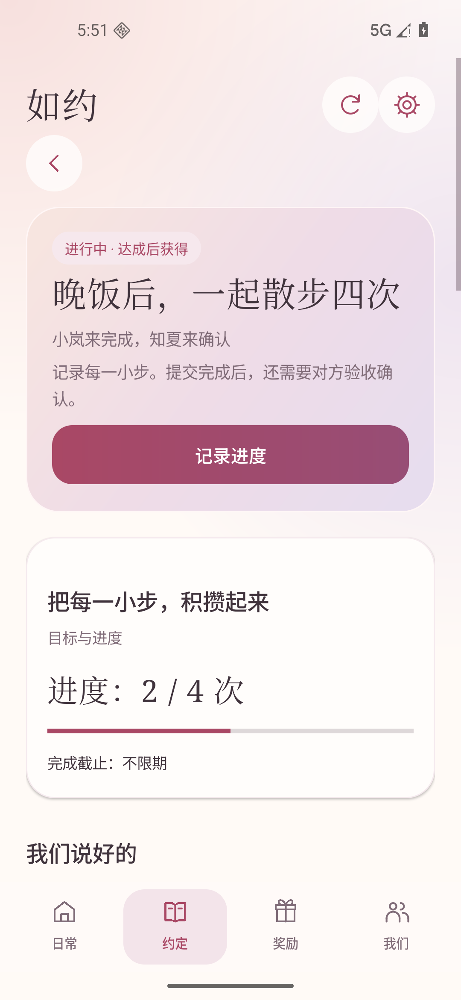
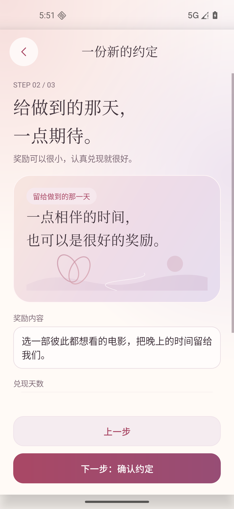

# Ruyue · 如约

**Promises, kept together. · 把答应，变成相伴。**

[简体中文](README.zh-CN.md) · [Project website](https://chenzhiyong1994.github.io/ruyue/) · [Development](docs/development.md) · [Contributing](CONTRIBUTING.md)

Ruyue is an Android app for private agreements between people who know each other: couples, family members, or two people working toward a shared commitment. Agree on the conditions and a reward, record progress, review the result, and confirm that the reward was actually received.

**This is a development preview, not a production service.** The repository contains the Android client and a backend you run yourself. There is no hosted account service or APK release to download; build the preview from source. The app interface is currently Simplified Chinese.

## A promise has two outcomes

Completing a task and receiving its reward are separate events:

```text
Propose → Accept → Record progress → Submit → Review
                                              ↓
                                      Reward pending
                                              ↓
                                      Giver marks given
                                              ↓
                                      Recipient confirms receipt
```

- **Private relationships:** invitations connect two real accounts; each relationship has its own records and access rules.
- **Clear terms:** one-time and cumulative goals, optional deadlines, reward descriptions, and a three-step creation flow.
- **Progress and evidence:** notes and photos support submission and review. Reaching a target does not automatically mean approval.
- **Mutual confirmation:** changes require agreement; the giver cannot unilaterally settle a reward. Ending a relationship does not erase an earned reward.
- **Explicit parent proxy mode:** a parent can record for a child without an account. Those actions retain their proxy origin; they are not presented as the child's independent confirmation.
- **Shared state:** the backend controls permissions, versions, time, and state transitions. Failed network requests do not count as successful actions.

There is no stranger marketplace, payment processing, points store, automatic punishment, background push notification service, or AI adjudication.

## Screenshots

Native Android screens with synthetic demonstration data.

| Daily view | Agreement details | Three-step creation |
| --- | --- | --- |
|  |  |  |

## Run locally

You need Python **3.11+**, **JDK 17**, and an Android SDK with **Platform 36**, SDK Build-Tools, and Platform-Tools. Set `JAVA_HOME` and `ANDROID_HOME` for your installations, and put `adb` on `PATH`. The app supports **Android 8.0 / API 26+**. Gradle is provided by the checked-in wrapper; the first build downloads dependencies.

```sh
git clone https://github.com/chenzhiyong1994/ruyue.git
cd ruyue
python -m server --host 127.0.0.1 --port 8765 --database .local/pact/pact.sqlite3
```

Use `python3` if that is the Python 3.11+ command on your system. The backend has no third-party Python dependencies. Keep it running, then build in another terminal at the repository root.

**Windows PowerShell:**

```powershell
.\scripts\android.ps1
```

**macOS / Linux:**

```sh
sh android/gradlew -p android :app:testDebugUnitTest :app:assembleDebug :app:lintDebug
```

The debug APK is `android/app/build/outputs/apk/debug/app-debug.apk`, with package ID `cn.zhiya.pact.preview`.

To connect an Android device or emulator to this local development server, replace `<device-serial>` with the value shown by `adb devices`:

```sh
adb -s "<device-serial>" install -r android/app/build/outputs/apk/debug/app-debug.apk
adb -s "<device-serial>" reverse tcp:8765 tcp:8765
```

Open the app's **开发连接设置** (development connection settings), set the service address to `http://127.0.0.1:8765`, and register a test account. Repeat for a second device and account connected to the same backend to try the complete shared flow. `adb reverse` is only a local development connection, not remote hosting.

The backend is not production-deployed. Public operation needs HTTPS, production signing, account recovery, backup and restore procedures, and an operational security review. The static project website does not host account data or the API. See [development setup](docs/development.md) and [security](SECURITY.md).

## Documentation

| Document | Contents |
| --- | --- |
| [Development](docs/development.md) | Toolchain, local backend, Android builds, configuration |
| [Testing](docs/testing.md) | Unit, HTTP, Android, and isolated two-device checks |
| [User guide](docs/user-guide.md) | App walkthrough, in Chinese |
| [Product requirements](docs/prd.md) | Scope and product rules, in Chinese |
| [API contract](docs/api.md) | Endpoints, permissions, and state transitions, in Chinese |
| [Architecture](docs/architecture.md) | Identity, storage, and consistency, in Chinese |
| [Acceptance criteria](docs/acceptance.md) | Stable PA-001–PA-009 checks, in Chinese |

## Contributing and license

Small, focused fixes and improvements are welcome. Read [CONTRIBUTING.md](CONTRIBUTING.md) before changing a workflow or contract, and use [SECURITY.md](SECURITY.md) for vulnerability reports.

Ruyue is licensed under the [MIT License](LICENSE). Bundled third-party components retain their own licenses; see [NOTICE](NOTICE).
