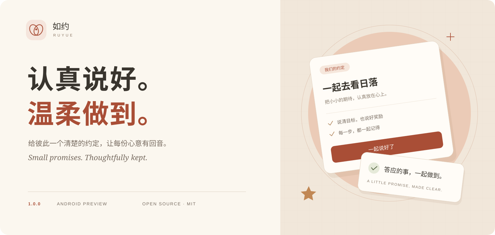
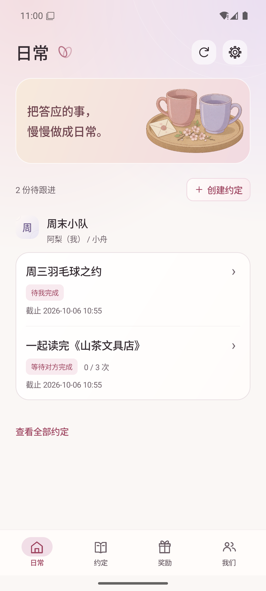
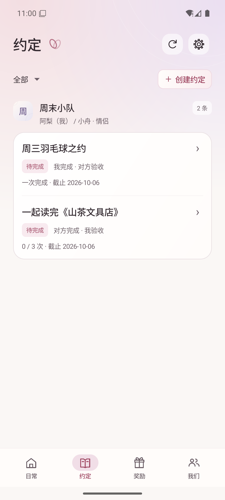
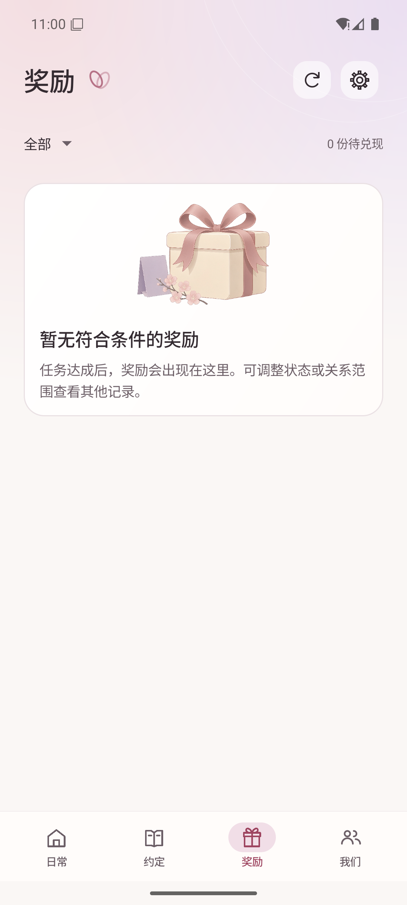

<p align="center">
  <a href="README.zh-CN.md">简体中文</a> ·
  <a href="https://chenzhiyong1994.github.io/ruyue/en/">Project page</a> ·
  <a href="https://github.com/chenzhiyong1994/ruyue/releases/tag/v1.0.0">Get 1.0.0</a> ·
  <a href="docs/download.md#english-quick-start">Setup guide</a> ·
  <a href="docs/development.md">Development</a>
</p>

# Ruyue · 如约

**Small promises, thoughtfully kept.** Ruyue gives private agreements a clear home: decide on a goal and a reward, accept the terms, record progress, review completion, and follow through.

An open-source **native Android app + Python backend**, with a warm Simplified Chinese interface. The **1.0.0 development preview** is available for Android 8.0 and newer. Run your own backend to explore the shared workflow; no hosted account service is provided.

## Download 1.0.0

| Get started | Download |
| --- | --- |
| **Android preview** · Android 8.0+ | [**Download APK ↓**](https://github.com/chenzhiyong1994/ruyue/releases/download/v1.0.0/ruyue-1.0.0-preview.apk) |
| **Source code** · Includes the Python backend | [Download source ZIP](https://github.com/chenzhiyong1994/ruyue/archive/refs/tags/v1.0.0.zip) |
| **Release details** · Checksums and build information | [Release notes & files](https://github.com/chenzhiyong1994/ruyue/releases/tag/v1.0.0) |

**First time here?** Follow the [installation guide](docs/download.md#english-quick-start): start the Python service, install the APK, then connect a test account. Both participants need the same backend. The APK is a debug-signed development preview, with version code **13**; use synthetic data for evaluation.

Public version 1.0.0 renumbers the earlier internal 1.4.3 snapshot while increasing the Android version code. See [download and upgrade notes](docs/download.md) before updating an existing installation.

## What it does

```text
Awaiting acceptance → In progress → Awaiting review → Reward pending → Fulfilled
待接受              待完成         待验收             待兑现           已兑现
```

The reward giver marks the reward fulfilled to close the agreement. The recipient does not confirm receipt a second time. Task completion and reward fulfillment remain separate states.

- **Private relationships:** invitations connect two accounts, with records and permissions scoped to each relationship.
- **Clear terms:** one-time or cumulative goals, optional deadlines, a reward, and a three-step creation flow. Changes to active terms require agreement.
- **One progress history:** creation, acceptance, progress notes and photos, submission, review, and fulfillment appear together. There is no separate “leave a note” action.
- **Explicit parent proxy mode:** a parent can record for a child without an account. The history identifies the actual actor and proxy source.
- **Shared state:** the service controls permissions, versions, time, and transitions. Ending a relationship does not erase an earned reward.

There is no stranger marketplace, payment processing, points store, automatic punishment, background push service, or AI adjudication.

## Screenshots

Native Android screens using synthetic demonstration data.

| Daily | Agreements | Rewards |
| --- | --- | --- |
|  |  |  |

The two decorative still-life illustrations were generated with AI and are bundled locally. Their source, prompts, and usage are documented in [Illustration provenance](docs/design/ruyue-illustrations.md).

## Build from source

Prepare **Python 3.11+**, **JDK 17**, and an Android SDK with **Platform 36**, SDK Build-Tools, and Platform-Tools. Set `JAVA_HOME` and `ANDROID_HOME`, and add `adb` to `PATH`. The app supports **Android 8.0 / API 26+**. Use the included Gradle Wrapper; the first build requires internet access to download dependencies.

```sh
git clone https://github.com/chenzhiyong1994/ruyue.git
cd ruyue
python -m server --host 127.0.0.1 --port 8765 --database .local/pact/pact.sqlite3
```

Use `python3` if appropriate for your system. The backend uses only the Python standard library. Leave it running and build in another terminal from the repository root.

**Windows PowerShell:**

```powershell
.\scripts\android.ps1
```

**macOS / Linux:**

```sh
sh android/gradlew -p android :app:testDebugUnitTest :app:assembleDebug :app:lintDebug
```

Install the generated Debug APK on an explicitly selected test device. Replace `<device-serial>` with its value from `adb devices`:

```sh
adb -s "<device-serial>" install -r android/app/build/outputs/apk/debug/app-debug.apk
adb -s "<device-serial>" reverse tcp:8765 tcp:8765
```

Open **开发连接设置** (development connection settings), enter `http://127.0.0.1:8765`, and register a synthetic test account. Use a second device and a different account connected to the same backend to try the shared workflow. The Debug package is `cn.zhiya.pact.preview`. Do not uninstall or clear an existing app to force an installation.

## Architecture and limits

The native Java client talks to a Python standard-library HTTP service, which stores accounts, relationships, agreements, events, and media in SQLite. The server is authoritative; both participants need the same backend. The [project page](https://chenzhiyong1994.github.io/ruyue/) is a static showcase and does not run the API.

This prototype does not provide production hosting, account recovery, managed backups, operational support, or a maintained security support window. Debug signing and a successful local build are not production-readiness guarantees. Use synthetic data for evaluation. See [Security](SECURITY.md) before considering any deployment beyond local testing.

Regular app development has been paused since September 30, 2026. This 1.0.0 release packages the existing features for download; the project remains experimental and unfinished. Continued development, maintenance, responses to issues or pull requests, and security fixes are not promised.

| Document | Contents |
| --- | --- |
| [Download and setup](docs/download.md) | APK, checksums, local connection, and upgrade notes |
| [Development](docs/development.md) | Toolchain, local service, Android build and configuration |
| [Testing](docs/testing.md) | Unit, HTTP, Android and isolated native checks |
| [User guide](docs/user-guide.md) | App walkthrough, in Chinese |
| [Product scope](docs/prd.md) | Goals and product boundaries, in Chinese |
| [API contract](docs/api.md) | Permissions and state transitions, in Chinese |
| [Architecture](docs/architecture.md) | Storage and consistency, in Chinese |
| [Acceptance criteria](docs/acceptance.md) | PA-001–PA-009 checks, in Chinese |

## Forks and license

Independent forks are welcome. Issues and pull requests may remain unanswered while development is paused; submitting one does not create a maintenance commitment. See [Contributing](CONTRIBUTING.md).

Ruyue is licensed under the [MIT License](LICENSE), without warranty. Third-party components retain their own licenses; see [NOTICE](NOTICE).
